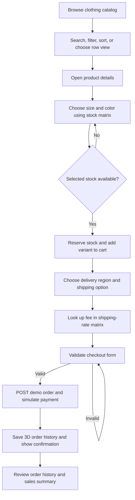

# Damitan ni Ron — Study Notes and Project Documentation

These notes describe the storefront as it is implemented in this project. The site is a desktop-only school-project demo; the checkout does not collect real payment information.

## Project overview

Damitan ni Ron is a clothing storefront that loads products from FakeStore API and keeps men's and women's clothing. Visitors can search, filter, sort, see product details, choose a size and color from live stock, add clothing variants to a saved cart, choose shipping by region, and submit a demo order. Completed orders are stored locally as nested arrays and can be reviewed with a small sales summary.

### Feature list

- Search, category and price filters, sorting, and grid/row catalog layouts.
- Product details loaded from the API, including size/color stock matrix and size guide.
- Local stock reservations by product, size, and color.
- Persistent cart with variant-specific quantities and subtotals.
- Checkout validation, regional shipping-rate lookup, and order confirmation.
- Local order history and category sales summary.
- Wishlist, light/dark mode, newsletter form, responsive desktop columns, and reduced-motion support.

### Folder structure

```text
damitan-ni-ron/
├── assets/
│   └── product-placeholder.svg
├── css/
│   └── styles.css
├── js/
│   ├── api.js
│   ├── cart-item.js
│   ├── cart-model.js
│   ├── cart.js
│   ├── main.js
│   ├── matrix.js
│   ├── order.js
│   ├── product.js
│   ├── state.js
│   ├── ui.js
│   ├── utils.js
│   └── validation.js
├── index.html
├── server.js
├── start.bat
├── README.md
└── DOCUMENTATION.md
```

## Setup guide

1. Install Node.js LTS.
2. On Windows, double-click `start.bat`. It starts the built-in static server and opens the site in your browser.
3. Keep the command window open while using the site. Press **Ctrl+C** to stop the server.
4. Alternatively, open `index.html` through VS Code Live Server. ES modules need an HTTP server; directly opening a `file://` URL may be blocked by browser security.
5. Keep an internet connection available for FakeStore API product and category data.

## API and endpoints used

Base URL: `https://fakestoreapi.com`

| Method | URL | Purpose | Where called |
|---|---|---|---|
| GET | `/products` | Get the full product response; only validated men's and women's clothing become storefront products. | `ApiService.getCatalog()` in `js/api.js`, started by `loadCatalog()` in `js/main.js`. |
| GET | `/products/categories` | Get category names and retain the two clothing categories. | `ApiService.getCatalog()` in `js/api.js`, concurrently with the product request. |
| GET | `/products/{id}` | Fetch the selected product detail. | `ApiService.getProduct()` in `js/api.js`, called by `openProductDetails()` in `js/main.js`. |
| POST | `/carts` | Create a demo cart snapshot for cart synchronization or checkout. | `ApiService.createCart()` in `js/api.js`; used by `syncCartWithApi()` and `submitOrder()` in `js/cart.js`. |
| PUT | `/carts/{id}` | Update the demo API cart when a saved cart changes. | `ApiService.updateCart()` in `js/api.js`, called by `syncCartWithApi()` in `js/cart.js`. |
| DELETE | `/carts/{id}` | Clear a remote cart after it becomes empty, an order completes, or the user cancels. | `ApiService.deleteCart()` in `js/api.js`, called from `js/cart.js`. |

FakeStore API is a teaching/demo API. A successful API response is not a real shipment or payment.

## User flow



## Master summary table

| Lesson | Main files | Key classes/functions | Feature visible in the demo |
|---|---|---|---|
| Classes and OOP | `js/product.js`, `js/cart-item.js`, `js/cart-model.js`, `js/order.js`, `js/api.js`, `js/ui.js` | `Product`, `ClothingProduct`, `CartItem`, `Cart`, `Order`, `ApiService`, renderers | Product models, variant-aware cart, API service, and reusable renderers. |
| Functions | `js/utils.js`, `js/main.js`, `js/matrix.js` | `formatCurrency`, `debounce`, `filterBy`, `sortBy`, `createCartCounter`, `chunk` | Search delay, sorting, currency display, and grid-to-row conversion. |
| Objects | `js/product.js`, `js/order.js`, `js/cart-model.js`, `js/main.js` | `toJSON()`, state snapshots, `Object.fromEntries()` | Product/rating data, order and customer data, local persistence. |
| Arrays | `js/api.js`, `js/cart-model.js`, `js/state.js`, `js/ui.js` | `getCatalog()`, `Cart`, `getVisibleProducts()` | Filtering, sorting, totals, cart lines, and rendering. |
| Multidimensional arrays | `js/matrix.js`, `js/ui.js`, `js/main.js` | `getStockMatrix`, `renderLabeledMatrixTable`, `getShippingFee`, `renderOrderHistory` | Variant stock, size charts, row layout, shipping costs, order history, sales summary. |
| DOM manipulation | `js/ui.js`, `index.html` | `ProductRenderer`, `CartRenderer`, `OrderHistoryRenderer` | Product cards, stock and size tables, cart lines, and order history are rendered dynamically. |
| Events | `js/main.js`, `js/cart-model.js` | `bindEvents()`, `cart:updated` | Filters, variants, cart controls, dialogs, keyboard actions, scroll, and resize. |
| Forms | `js/validation.js`, `js/main.js`, `index.html` | `validateField`, `validateCheckoutForm`, `onOrderSubmit` | Checkout, payment method, shipping options, terms, and newsletter validation. |
| Asynchronous JavaScript | `js/api.js`, `js/cart.js`, `js/main.js`, `js/utils.js` | `ApiService`, `loadCatalog`, `submitOrder`, `debounce` | Concurrent catalog requests, details requests, cart writes, and simulated payment. |

## Demo script

| Step | What to click or show | Lesson demonstrated | File to open |
|---|---|---|---|
| 1 | Start the site with `start.bat`; point out the header, category filter, other filters, and desktop grid. | CSS, DOM, asynchronous catalog loading | `index.html`, `css/styles.css`, `js/main.js` |
| 2 | Search for a product, choose a category, sort by price, then click **Grid view / Row view**. | Functions, arrays, events, 2D chunked rows | `js/utils.js`, `js/matrix.js`, `js/main.js` |
| 3 | Open a product card. Click size/color choices and inspect the stock table; click **Size guide**. | 2D arrays, nested rendering, DOM events | `js/matrix.js`, `js/ui.js`, `js/main.js` |
| 4 | Add a variant, open the bag, increase/decrease quantity, and remove it. | OOP, encapsulation, immutable data, inventory update | `js/cart-item.js`, `js/cart-model.js`, `js/matrix.js` |
| 5 | Open checkout and change delivery region and shipping option. Watch the fee and total change. | Forms, 2D lookup table, event handlers | `index.html`, `js/matrix.js`, `js/main.js`, `js/ui.js` |
| 6 | Submit valid demo details and show the confirmation. | Validation, async/await, API calls, order objects | `js/validation.js`, `js/cart.js`, `js/order.js` |
| 7 | Click **Order history** in the footer and describe one order's item rows and the sales summary. | 3D arrays, `flat`, `flatMap`, nested `reduce` | `js/matrix.js`, `js/ui.js` |
| 8 | Toggle dark mode and wishlist; show the design's keyboard focus styling. | Objects, localStorage, events, CSS state classes | `js/main.js`, `js/ui.js`, `css/styles.css` |

## Rubric mapping

| Rubric component | Evidence in the project |
|---|---|
| OOP | Private state and validated accessors in `js/product.js` and `js/cart-model.js`; inheritance in `ClothingProduct`; API and renderer classes in `js/api.js` and `js/ui.js`. |
| Objects | Nested product ratings and order/customer objects; destructuring and immutable copies in `js/product.js`, `js/order.js`, and `js/main.js`. |
| Arrays | Product/cart collections, array iteration, filter/sort/search, and totals in `js/api.js`, `js/cart-model.js`, `js/ui.js`, and `js/utils.js`. |
| DOM | DOM nodes and delegated actions in `js/ui.js` and `js/main.js`; semantic page/dialog structure in `index.html`. |
| CSS | Variables, desktop grid breakpoints, hover/focus states, dialog/drawer styling, theme and motion preferences in `css/styles.css`. |
| Async | Fetch requests, `Promise.all`, status checks, error/retry states, and async checkout in `js/api.js`, `js/cart.js`, and `js/main.js`. |
| Data Integration | FakeStore GET/POST/PUT/DELETE methods in `js/api.js`; stock, shipping, and local history data in `js/matrix.js`. |
| System Functionality | Search, filters, cart variants, form validation, shipping totals, order confirmation, and order history across `js/main.js`, `js/state.js`, `js/cart.js`, and `js/ui.js`. |
| Code Quality | ES modules, focused classes, copied state updates, helper functions, and JSDoc comments across the `js/` folder. |
| Documentation | This `DOCUMENTATION.md` and the setup/API overview in `README.md`. |
| Presentation | The demo sequence above and the per-lesson speaking notes below. |

## Screenshots to capture

- `screenshots/storefront.png` — full desktop home, category cards, and product grid.
- `screenshots/product-stock-matrix.png` — product detail with size/color buttons and stock table.
- `screenshots/size-guide.png` — men's or women's size guide dialog.
- `screenshots/shipping-checkout.png` — region, shipping option, lookup table, and updated order total.
- `screenshots/order-confirmation.png` — completed demo order confirmation.
- `screenshots/order-history.png` — nested order rows and category sales summary.

---

### Lesson 1: JavaScript Classes and OOP

1. **What it is** - A class is a reusable blueprint for creating objects. Object-oriented programming groups data and the operations that use that data together, while inheritance lets a specialized class reuse a general class.

2. **How it works** - A constructor initializes each new object. Private fields are hidden from outside code, getters/setters control access, and child classes can call `super()` and override a method.

```js
class Vehicle {
  #speed = 0;
  set speed(value) { this.#speed = Math.max(0, value); }
  get speed() { return this.#speed; }
}
class Bicycle extends Vehicle {
  describe() { return `Bicycle at ${this.speed}`; }
}
```

3. **How it is used in this project** - `Product` validates product IDs and prices behind private fields. `ClothingProduct` extends it with clothing sizes and gender. `Cart` keeps the item array private and provides methods for cart operations. `ApiService` owns network requests, while renderer classes create UI.

4. **Where the code is**

| File | Class / Function | What it does | Approx. lines |
|---|---|---|---|
| `js/product.js` | `Product` | Constructor, `#id`, `#price`, validated accessors, static factory, serialization. | ~8–92 |
| `js/product.js` | `ClothingProduct extends Product` | Calls `super()` and overrides `getDescription()`. | ~95–112 |
| `js/cart-item.js` | `CartItem` | Stores a product reference, quantity, size, and color; computes subtotal. | ~4–33 |
| `js/cart-model.js` | `Cart` | Encapsulates cart items and exposes cart operations. | ~9–111 |
| `js/order.js` | `Order` | Creates a JSON-safe order snapshot. | ~7–37 |
| `js/api.js` | `ApiService` | Encapsulates GET, POST, PUT, and DELETE requests. | ~8–78 |
| `js/ui.js` | `ProductRenderer`, `CartRenderer`, `OrderHistoryRenderer` | Keeps DOM rendering in renderer objects. | ~419–449 |

5. **Code snippet from the project**

```js
#id; // Private field: outside code cannot directly read or change it.
get id() { return this.#id; } // Getter provides controlled read access.
set id(value) { // Setter is the controlled write path.
  const identifier = Number(value); // Convert input before validating it.
  if (!Number.isInteger(identifier) || identifier < 1) throw new RangeError('Product id must be a positive whole number.'); // Reject invalid IDs.
  this.#id = identifier; // Store only a validated ID.
}
```

This is copied from `Product` in `js/product.js` (~9, 27–34).

```js
export class ClothingProduct extends Product { // ClothingProduct is the child class.
  constructor(data) { // The child receives clothing data.
    super(data); // The parent initializes common product properties.
    this.gender = data.gender ?? (data.category === "men's clothing" ? 'Men' : 'Women'); // Add clothing-specific data.
    this.size = [...(data.sizes ?? ['S', 'M', 'L', 'XL'])]; // Copy the available sizes into this clothing object.
  }
  getDescription() { // Override the parent's method.
    return `${super.getDescription()} Available sizes: ${this.size.join(', ')}.`; // Reuse parent behavior and extend it.
  }
}
```

This is copied from `js/product.js` (~95–109).

6. **How to explain it in the presentation**

- “`Product` is the parent class. `ClothingProduct` is a child class that adds clothing information.”
- “The `#` fields are private, and the setters validate data before storing it.”
- “`Cart` hides its internal item list and provides methods so the rest of the website cannot edit that array directly.”
- **Likely question:** What is method overriding? **Sample answer:** “The child class defines its own `getDescription()` method, so it can add sizes while still reusing the parent method with `super`.”

### Lesson 2: JavaScript Functions

1. **What it is** - A function is reusable code that performs a task. JavaScript supports declarations, function expressions, arrow functions, callbacks, and functions that return other functions.

2. **How it works** - A higher-order function accepts or returns another function. A closure remembers variables from the scope where it was created. Default and rest parameters let a function handle optional or variable arguments.

```js
function greet(name = 'Guest') {
  return `Hello, ${name}`;
}
const makeAdder = (amount) => (value) => value + amount;
const addFive = makeAdder(5);
```

3. **How it is used in this project** - The storefront uses a named function declaration for `publish`, a named function expression for `formatCurrency`, and arrow functions for most event callbacks and transformations. `filterBy` and `sortBy` are higher-order helpers. `debounce` and `createCartCounter` keep state in closures.

4. **Where the code is**

| File | Class / Function | What it does | Approx. lines |
|---|---|---|---|
| `js/state.js` | `publish()` | Function declaration that notifies subscribers. | ~27–29 |
| `js/utils.js` | `formatCurrency` | Named function expression for money formatting. | ~2–8 |
| `js/utils.js` | `debounce` | Closure that delays work until typing pauses. | ~10–17 |
| `js/utils.js` | `filterBy`, `sortBy` | Higher-order functions returning reusable operations. | ~62–75 |
| `js/utils.js` | `createCartCounter` | Closure exposing controlled count operations. | ~78–85 |
| `js/matrix.js` | `chunk` | Splits product lists into row arrays. | ~94–101 |
| `js/main.js` | `bindEvents()` | Registers callbacks for user events. | ~462–716 |

5. **Code snippet from the project**

```js
export const debounce = (callback, delay = 250) => { // Arrow function with a default parameter.
  let timeoutId; // The returned function closes over this timer ID.
  return (...args) => { // Rest parameter collects every callback argument.
    window.clearTimeout(timeoutId); // Cancel the previous pending callback.
    timeoutId = window.setTimeout(() => callback(...args), delay); // Spread the saved arguments after a pause.
  };
};
```

This is copied from `js/utils.js` (~10–17).

```js
export const filterBy = (predicate) => (items = []) => items.filter(predicate); // Returns a reusable filtering function.
```

This is copied from `js/utils.js` (~62).

6. **How to explain it in the presentation**

- “The search uses `debounce` so the page waits briefly after typing before rebuilding the product list.”
- “`filterBy` accepts a condition and returns a function that applies it to an array.”
- “The cart counter closure keeps its count private and exposes `get`, `set`, and `increment` methods.”
- **Likely question:** What does a closure remember? **Sample answer:** “It remembers variables from the function where it was created, such as the debounce timer or cart count.”

### Lesson 3: JavaScript Objects

1. **What it is** - An object stores related values as named properties. A property can itself contain another object, so a product can keep its rating as a nested object.

2. **How it works** - Destructuring reads properties into variables; spread makes a shallow copy; `Object.entries()` turns properties into key/value pairs; JSON methods convert data to and from text for storage or transfer.

```js
const item = { name: 'Jacket', rating: { stars: 4.5 } };
const { name, rating } = item;
const copy = { ...item, name: 'Coat' };
const text = JSON.stringify(copy);
```

3. **How it is used in this project** - API products have nested rating data; cart and order lines combine a product object with a quantity and selected variant. State updates copy objects rather than changing shared snapshots. JSON is used at localStorage and API boundaries.

4. **Where the code is**

| File | Class / Function | What it does | Approx. lines |
|---|---|---|---|
| `js/product.js` | `Product.constructor`, `toJSON()` | Builds nested rating data and serializes private fields. | ~18–25, ~80–91 |
| `js/order.js` | `Order.constructor`, `toJSON()` | Copies customer details and serializes nested order lines. | ~12–37 |
| `js/cart-model.js` | `save()`, `load()` | Uses JSON for persistent cart data. | ~87–110 |
| `js/state.js` | `setCatalog()`, `publish()` | Uses spread to publish a new state snapshot. | ~27–49 |
| `js/main.js` | `onOrderSubmit()` | Uses `FormData` and `Object.fromEntries()` to make the customer object. | ~386–416 |
| `js/matrix.js` | `getStockMatrix()`, `recordOrderHistory()` | Parses and stringifies nested stored records. | ~123–137, ~194–218 |

5. **Code snippet from the project**

```js
this.rating = { rate: data.rating?.rate ?? 0, count: data.rating?.count ?? 0 }; // A nested object stores rating values together.
```

This is copied from `js/product.js` (~23).

```js
const formData = new FormData(elements.checkoutForm); // Read the named form controls.
const { cardNumber: _cardNumber, terms: _terms, ...customer } = Object.fromEntries(formData.entries()); // Convert entries to an object and exclude sensitive/non-customer fields.
customer.shippingFee = getShippingFee(customer.region, customer.shipping); // Add the computed delivery cost.
```

This is copied from `js/main.js` (~396–398).

6. **How to explain it in the presentation**

- “A product is an object, and its rating is another object nested inside it.”
- “The cart stores a product object together with quantity, size, and color.”
- “Spread copies the outside object so state updates do not rewrite an older snapshot.”
- **Likely question:** Is object spread a deep copy? **Sample answer:** “No. It is shallow, so nested objects still need their own copy if they will be changed.”

### Lesson 4: JavaScript Arrays

1. **What it is** - An array is an ordered list of values. Array methods let the project transform, search, sort, and summarize products and cart lines.

2. **How it works** - `map()` transforms values; `filter()` keeps matches; `find()` returns one match; `reduce()` calculates a summary; `some()` and `every()` test conditions; `sort()` orders values; `includes()` checks membership.

```js
const prices = [12, 8, 20];
const discounted = prices.filter((price) => price > 10).map((price) => price - 1);
const total = discounted.reduce((sum, price) => sum + price, 0);
```

3. **How it is used in this project** - Products, cart items, stock rows, chart rows, and order records are all arrays. Cart updates use `map()` and `filter()` to create new arrays rather than mutating the current list.

4. **Where the code is**

| File | Class / Function | What it does | Approx. lines |
|---|---|---|---|
| `js/api.js` | `ApiService.getCatalog()` | Maps API objects to products and filters invalid/non-clothing results. | ~30–43 |
| `js/cart-model.js` | `addItem`, `updateQuantity`, `getTotal` | Uses `some`, `find`, `map`, `filter`, and `reduce`. | ~38–79 |
| `js/ui.js` | `getVisibleProducts()` | Filters and sorts the current product array. | ~390–415 |
| `js/matrix.js` | `updateCell`, `sumMatrix`, `getSalesSummary` | Applies array methods to nested matrix rows. | ~63–80, ~226–239 |
| `js/main.js` | `renderListing()` | Filters the full catalog by saved IDs and current controls. | ~129–151 |

5. **Code snippet from the project**

```js
this.#items = current // Start an immutable replacement of the private array.
  ? this.#items.map((item) => isSameVariant(item) // Visit each existing cart line.
    ? new CartItem(item.product, item.quantity + 1, variant) // Replace only the matching variant.
    : item) // Keep other line objects unchanged.
  : [...this.#items, new CartItem(product, 1, variant)]; // Otherwise make a new array with the new line.
```

This is copied from `js/cart-model.js` (~44–48).

6. **How to explain it in the presentation**

- “The product list is an array, and filters produce a new visible list.”
- “`reduce()` adds cart subtotals to compute a total.”
- “Cart changes use `map()` and `filter()` to create a replacement array rather than changing the old one.”
- **Likely question:** Why make a new array? **Sample answer:** “It helps keep state updates predictable and avoids changing data that another part of the UI may still be using.”

### Lesson 5: Multidimensional Arrays

1. **What it is** - A 2D array is an array of rows; a 3D array is an array of 2D arrays. A row and column can represent meaningful coordinates, such as size and color, instead of storing values in a flat list.

2. **How it works** - Nested loops or nested `map()` calls process row/column values. `transpose()` swaps rows and columns, `flat()`/`flatMap()` summarize nested data, and an immutable cell update makes copied rows instead of changing the original matrix.

```js
const stock = [[3, 0], [2, 4]];
const total = stock.reduce((sum, row) => sum + row.reduce((rowSum, qty) => rowSum + qty, 0), 0);
const rows = [[['A']], [['B']]];
const flatItems = rows.flatMap((order) => order.flat());
```

3. **How it is used in this project** - `js/matrix.js` owns the matrix data helpers. Stock matrices use sizes as rows and colors as columns; men's and women's charts are 2D arrays; `chunk()` converts products into rows for the alternate layout; the shipping rates use zone rows and option columns. Order history is a 3D array where each item is `[productId, title, size, color, quantity, price]`. The UI module receives these arrays and renders tables or rows; it does not own their business logic.

4. **Where the code is**

| File | Class / Function | What it does | Approx. lines |
|---|---|---|---|
| `js/matrix.js` | `SIZES`, `COLORS`, `getStockMatrix()` | Provides a `[sizeIndex][colorIndex]` stock matrix per product. | ~1–6, ~123–137 |
| `js/matrix.js` | `reserveStock()`, `releaseStock()`, `updateCell()` | Updates inventory by replacing matrix rows immutably. | ~63–72, ~139–164 |
| `js/matrix.js` | `MEN_SIZE_CHART`, `WOMEN_SIZE_CHART` | Stores two separate size charts. | ~14–25 |
| `js/matrix.js` | `chunk()` | Turns product data into an array of rows for row layout. | ~94–101 |
| `js/matrix.js` | `SHIPPING_RATES`, `getShippingFee()` | Looks up a fee as `[zoneIndex][optionIndex]`. | ~3–12, ~170–175 |
| `js/matrix.js` | `recordOrderHistory()`, `getHistoryTotals()` | Persists order → item → six-value item row, then totals nested data. | ~194–218, ~242–248 |
| `js/matrix.js` | `getSalesSummary()` | Builds a category/quantity/revenue 2D summary from history. | ~226–239 |
| `js/matrix.js` | `transpose`, `flatten`, `getColumn`, `getRow`, `sumMatrix`, `findInMatrix` | Reusable 2D-array utilities, including empty and invalid index cases. | ~40–91 |
| `js/ui.js` | `ProductRenderer`, `OrderHistoryRenderer` | Renders product rows, stock/size tables, order history, and sales summary. | ~67–120, ~185–259, ~323–367, ~420–445 |
| `js/main.js` | `updateDetailSelection`, `renderShippingRates`, `onCartAction` | Connects matrix choices to UI and cart stock reservations. | ~226–235, ~355–383, ~322–353 |

5. **Code snippet from the project**

```js
return Array.from({ length: rowCount }, () => Array.from({ length: columnCount }, () => ( // Make a distinct row and cell for each position.
  fill && typeof fill === 'object' ? structuredClone(fill) : fill // Copy object fill values so neighboring cells do not share a reference.
)));
```

This is copied from `createMatrix()` in `js/matrix.js` (~35–37). For stock, the default fill is the number `0`, and each row is independently created; the code never uses `Array(rows).fill([])`.

```js
return matrix.map((row, index) => index === rowIndex // Build a new outer array.
  ? row.map((cell, cellIndex) => cellIndex === columnIndex ? value : cell) // Build a new changed row.
  : [...row]); // Copy every unchanged row too.
```

This is copied from `updateCell()` in `js/matrix.js` (~69–72).

```js
const rows = orders.flat(); // Collapse the order-to-item level for line counting.
const units = orders.reduce((total, order) => total + order.reduce((orderTotal, row) => orderTotal + (Number(row[4]) || 0), 0), 0); // Sum item quantities with nested reductions.
const flatMapUnits = orders.flatMap((order) => order).reduce((total, row) => total + (Number(row[4]) || 0), 0); // Flatten order rows and sum purchased units.
```

This is copied from `getHistoryTotals()` in `js/matrix.js` (~243–245).

6. **How to explain it in the presentation**

- “In the stock matrix, the first index chooses a size row and the second index chooses a color column.”
- “The order history is three levels deep: orders, item rows, then the six values in each item row.”
- “The stock update creates new arrays at each level. This avoids mutating a matrix that another part of the code may be reading.”
- **Likely question:** Why not use `Array(5).fill([])` for the stock rows? **Sample answer:** “That would put the same row array in every position. Changing one row could appear to change all of them, so I create each row separately with `Array.from()`.”

### Lesson 6: JavaScript DOM Manipulation

1. **What it is** - The DOM is the browser's object representation of the HTML page. JavaScript can create, update, move, and remove DOM nodes to display data.

2. **How it works** - `createElement()` makes a node; `textContent` safely inserts text; `appendChild()` or `append()` places nodes. Event delegation lets one parent handle actions from its current or future children.

```js
const heading = document.createElement('h2');
heading.textContent = 'New arrivals';
container.appendChild(heading);
heading.classList.add('is-visible');
```

3. **How it is used in this project** - Product cards, cart rows, stock tables, size charts, sales summaries, and order history are generated from data. Product and cart DOM code lives in renderer classes in `js/ui.js`, separate from the models and API layer. Dynamic user-entered text is set with `textContent`; the product wishlist uses a fixed, static SVG string as `innerHTML`.

4. **Where the code is**

| File | Class / Function | What it does | Approx. lines |
|---|---|---|---|
| `js/ui.js` | `createElement()` | Shared DOM node helper. | ~4–10 |
| `js/ui.js` | `createProductCard()`, `renderProductsDom()` | Creates product cards and renders layout rows. | ~12–78 |
| `js/ui.js` | `renderCartDom()` | Builds cart rows and updates badge/totals. | ~122–181 |
| `js/ui.js` | `renderProductDetailsDom()` | Builds size/color buttons and stock matrix table. | ~185–259 |
| `js/matrix.js` | `renderMatrixTable()`, `renderLabeledMatrixTable()` | Builds semantic tables using DOM methods. | ~251–320 |
| `js/ui.js` | `OrderHistoryRenderer` | Renders nested order records and sales summary. | ~323–367, ~442–445 |
| `js/main.js` | `bindEvents()` | Delegates product/cart/detail actions from parent containers. | ~462–738 |

5. **Code snippet from the project**

```js
const cell = document.createElement('td'); // Make a table data cell.
const button = document.createElement('button'); // Make an interactive stock cell.
button.type = 'button'; // Prevent the button from submitting any surrounding form.
button.dataset.action = 'select-variant'; // Store its delegated action in a data attribute.
button.dataset.size = String(size); // Store the chosen size on the node.
button.dataset.color = String(columnLabels[columnIndex]); // Store the chosen color on the node.
button.textContent = String(quantity); // Insert a safe text value.
button.disabled = Number(quantity) <= 0; // Disable unavailable combinations.
cell.appendChild(button); // Put the button into the table cell.
```

This is copied from `renderLabeledMatrixTable()` in `js/matrix.js` (~300–309).

6. **How to explain it in the presentation**

- “The product cards are not hardcoded in HTML; the renderer creates them from the loaded product array.”
- “`dataset` values tell the delegated event handler which product, size, color, or action was clicked.”
- “Text from API data is assigned with `textContent` instead of being interpreted as HTML.”
- **Likely question:** Why use event delegation? **Sample answer:** “The product cards are recreated when filters change, so the parent grid can handle clicks from new cards without attaching another listener to every button.”

### Lesson 7: JavaScript Events

1. **What it is** - An event is a signal that something happened, such as a click, typing, form submission, key press, scroll, or page load. Event listeners connect those signals to behavior.

2. **How it works** - Events bubble from the target element toward parent elements. A delegated handler can inspect `event.target`, call `closest()` to find the action node, and call `preventDefault()` when native browser behavior should not occur.

```js
form.addEventListener('submit', (event) => {
  event.preventDefault();
  console.log(event.currentTarget, event.target);
});
```

3. **How it is used in this project** - `bindEvents()` listens for click, input, change, submit, keydown, focus-in/out, scroll, resize, and DOMContentLoaded. The `Cart` dispatches a `cart:updated` `CustomEvent`; the header badge listens to it. Page-exit cleanup removes window and custom event listeners.

4. **Where the code is**

| File | Class / Function | What it does | Approx. lines |
|---|---|---|---|
| `js/main.js` | `bindEvents()` | Wires delegated clicks and input/change/submit/focus/keyboard actions. | ~462–738 |
| `js/main.js` | `onScroll()`, `onResize()` | Updates sticky-header and viewport state. | ~449–460 |
| `js/main.js` | `DOMContentLoaded` startup | Starts initialization after the document is ready. | ~743–750 |
| `js/cart-model.js` | `save()` | Dispatches `cart:updated` with current item data. | ~86–95 |
| `js/main.js` | `updateCartBadge()` | Listens for the custom cart event. | ~717–727 |
| `js/main.js` | `cleanupWindowEvents()` | Uses `removeEventListener()` at page exit. | ~729–738 |

5. **Code snippet from the project**

```js
elements.grid.addEventListener('click', (event) => { // One click listener serves every current/future product card.
  const action = event.target.closest('[data-action]'); // Find the button that was clicked, even if its SVG/text was the target.
  if (action?.dataset.action === 'wishlist') { // Choose the behavior from its dataset action.
    event.preventDefault(); // Prevent default action where needed.
    event.stopPropagation(); // Keep the click from also opening the product card.
    updateWishlist(action.dataset.productId, action); // Handle the selected product.
    return; // Do not fall through to other card behavior.
  }
});
```

This is copied from `bindEvents()` in `js/main.js` (~516–524).

6. **How to explain it in the presentation**

- “The grid listens once and uses event bubbling to identify which product button was pressed.”
- “The custom `cart:updated` event lets cart changes notify the header badge without tightly coupling the cart model to header markup.”
- “Escape closes the topmost dialog first, and the code removes long-lived listeners on `pagehide`.”
- **Likely question:** What is the difference between `target` and `currentTarget`? **Sample answer:** “`target` is where the event started; `currentTarget` is the element whose listener is currently running.”

### Lesson 8: JavaScript and Forms

1. **What it is** - HTML forms collect user input. JavaScript can combine browser constraint validation with custom rules and clear inline messages.

2. **How it works** - Controls use `required`, `type`, and other constraints. `checkValidity()` tests them, while `setCustomValidity()` supplies a custom message. `FormData` collects named fields and `Object.fromEntries()` converts entries to an object.

```js
const formData = new FormData(form);
const values = Object.fromEntries(formData.entries());
if (!form.checkValidity()) form.reportValidity();
```

3. **How it is used in this project** - The checkout validates contact and delivery fields, payment choice, optional demo card number when needed, region, shipping option, and terms. The submit button stays disabled until valid, then changes to a processing message while the order is sent. The newsletter also uses the Constraint Validation API.

4. **Where the code is**

| File | Class / Function | What it does | Approx. lines |
|---|---|---|---|
| `index.html` | `#checkout-form` | Checkout controls including selects, checkbox, and error regions. | ~275–346 |
| `js/validation.js` | `FIELD_RULES`, `validateField()` | Custom email/phone/ZIP/card/required-field validation. | ~1–39 |
| `js/validation.js` | `validateCheckoutForm()`, `setupCheckoutValidation()` | Validates all fields and disables/enables submit. | ~41–53 |
| `js/validation.js` | `validateNewsletterForm()` | Uses native form validity and custom email feedback. | ~56–68 |
| `js/main.js` | `openCheckout()`, `onOrderSubmit()` | Resets form UI, collects `FormData`, and displays loading/success states. | ~303–420 |
| `js/main.js` | `updateCheckoutSummary()` | Updates the total when region or shipping option changes. | ~220–224 |

5. **Code snippet from the project**

```js
const valid = rule.test(readFieldValue(form, name), field); // Apply this field's project rule.
const message = valid ? '' : rule.message; // Choose an empty or helpful error string.
field.setCustomValidity(message); // Tell the browser about custom validity.
const errorElement = document.getElementById(rule.id); // Find the matching inline error message.
errorElement.textContent = message; // Update that message without parsing HTML.
field.classList.toggle('is-invalid', !valid); // Style an invalid field.
field.classList.toggle('is-valid', valid); // Style a valid field.
```

This is copied from `validateField()` in `js/validation.js` (~30–37).

6. **How to explain it in the presentation**

- “I validate each checkout field as the customer types or leaves it.”
- “The same error message appears inline and is also set as the browser's custom validity message.”
- “The submit button is disabled until every required input passes validation.”
- **Likely question:** Why do you use `Object.fromEntries()`? **Sample answer:** “It converts the `FormData` key/value entries into a normal object that can be passed to the order function.”

### Lesson 9: Asynchronous JavaScript

1. **What it is** - Asynchronous JavaScript lets the page wait for slow work, such as network requests, without freezing the interface. A callback is a function passed to another function; a Promise represents a result that may arrive later; `async`/`await` makes Promise-based code easier to read.

2. **How it works** - `fetch()` returns a Promise. `await` pauses only the current async function; other browser work can continue. `try/catch/finally` handles failures and cleanup. `Promise.all()` waits for independent requests together.

```js
async function loadData() {
  try {
    const response = await fetch('/data');
    if (!response.ok) throw new Error('Request failed');
    return await response.json();
  } finally {
    console.log('Finished');
  }
}
```

3. **How it is used in this project** - `ApiService` checks HTTP status and parses API JSON. The product list and category list load concurrently; product details load when opened. The page shows skeletons while waiting and a retry button on failure. Once products are validated and converted to models, `main.js` creates a per-product stock matrix and the renderer builds the stock table. Checkout posts a demo cart, simulates payment with a timer-backed Promise, saves an order matrix, and shows confirmation.

4. **Where the code is**

| File | Class / Function | What it does | Approx. lines |
|---|---|---|---|
| `js/api.js` | `ApiService.request()` | Fetches JSON, checks `response.ok`, and throws HTTP errors. | ~19–29 |
| `js/api.js` | `ApiService.getCatalog()` | Uses `Promise.all()` and validates arrays. | ~31–45 |
| `js/main.js` | `loadCatalog()` | Shows loading state, requests data, renders or displays retry state. | ~153–196 |
| `js/main.js` | `openProductDetails()` | Fetches one product and builds its size/color matrix UI. | ~277–300 |
| `js/cart.js` | `syncCartWithApi()`, `submitOrder()` | Serializes remote writes and submits the demo checkout. | ~11–72 |
| `js/utils.js` | `simulatePaymentProcessing()` | Returns a Promise resolved by `setTimeout()`. | ~87–90 |
| `js/matrix.js` | `getStockMatrix()`, `recordOrderHistory()` | Prepares local multidimensional arrays after products/orders arrive. | ~123–137, ~194–218 |
| `js/ui.js` | `renderLoading()`, `renderProductState()` | Renders loading skeletons and retryable errors. | ~80–112 |

5. **Code snippet from the project**

```js
const [rawProducts, rawCategories] = await Promise.all([ // Start independent requests at the same time.
  this.request('/products'), // Request product data.
  this.request('/products/categories') // Request category names.
]);
if (!Array.isArray(rawProducts) || !Array.isArray(rawCategories)) { // Verify the expected data shape.
  throw new Error('The store returned an unexpected catalog response.'); // Do not render a success-shaped fallback.
}
```

This is copied from `ApiService.getCatalog()` in `js/api.js` (~32–38).

```js
const product = await fetchProductById(id); // Wait for the detail request.
if (requestId !== detailRequestId) return; // Ignore a stale response from an older selection.
renderProductDetails(product, elements.detailContent, getStockMatrix(product.id)); // Build the view using the product's current matrix.
```

This is copied from `openProductDetails()` in `js/main.js` (~290–293).

6. **How to explain it in the presentation**

- “Catalog products and categories load concurrently, which avoids waiting for one request before starting the other.”
- “The UI renders skeleton cards while data is loading and a retry action if the request fails.”
- “The detail request returns the product first; then the matrix module provides the saved inventory data, which the UI renders.”
- **Likely question:** What does `await` do? **Sample answer:** “It waits for a Promise inside an async function without blocking the whole browser page.”
