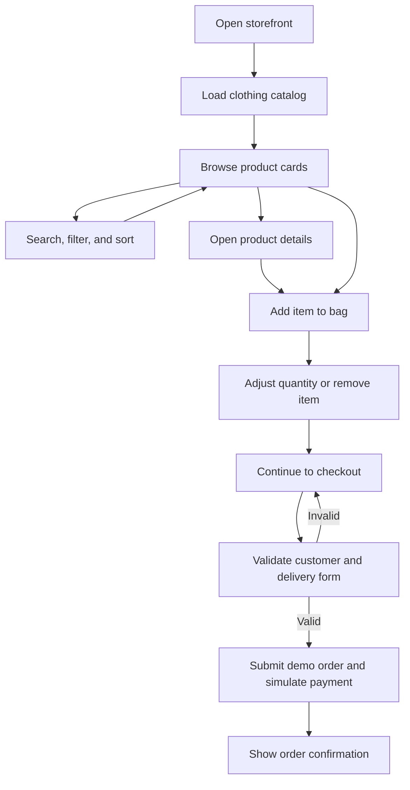

# Damitan ni Ron

A desktop-first, multi-page-feeling clothing storefront built with semantic HTML, CSS, and vanilla JavaScript ES modules. The collection is loaded from FakeStore API and limited to men's and women's clothing. Product details, filtering, wishlist, saved shopping bag, validated checkout, and order confirmation all work without a front-end framework.

> Checkout is a school-project demo. It does not collect or process real payments or retain the demo card number in the order.

## Features

- Desktop fashion storefront with a 1200px minimum page width, sticky navigation, category feature cards, and dynamically rendered product cards.
- Persisted light/dark themes and a saved-items wishlist.
- Search by product title, category filter, minimum/maximum price (including a range slider), and sorting.
- Product detail dialog fetched from the API.
- Product size/color stock matrix, selectable variants, stock-aware cart controls, and men's/women's size guides.
- Grid/row catalog layouts, live regional shipping rate lookup, and local order-history/sales summaries.
- Accessible slide-out bag with add/remove/quantity controls, subtotals, total, and saved contents.
- Validated checkout with inline feedback, payment/shipping choices, simulated payment, and order confirmation.
- Express shipping adds an $8 demo fee to the checkout summary; standard shipping is free.
- Newsletter sign-up demo with browser constraint validation.
- Loading skeletons, retryable errors, fallback product images, and toast feedback.
- Motion-reduced scroll reveals, keyboard focus states, a focus-trapped bag drawer, and responsive product columns at desktop widths.
- OOP model classes for products, cart items, carts, orders, and API access.

## Screenshots

Add screenshots captured from your running storefront here:

| Storefront | Product details | Checkout |
|---|---|---|
| `` | `` | `` |

## Setup and run

### Windows one-click launcher

1. Install [Node.js LTS](https://nodejs.org/) if it is not already installed.
2. Double-click `start.bat`.
3. The launcher starts a small local static server and opens the store in your browser. Keep its command window open; press **Ctrl+C** to stop the server.

The launcher uses only Node.js built-in modules. There is no `npm install` step.

### VS Code Live Server

Install the **Live Server** extension, right-click `index.html`, and choose **Open with Live Server**.

ES modules use browser module loading and should be served over HTTP. Opening `index.html` directly as a `file://` URL can be blocked by browser security rules. The live product catalog also requires an internet connection.

## Project structure

```text
damitan-ni-ron/
├── assets/
│   └── product-placeholder.svg
├── css/
│   └── styles.css
├── js/
│   ├── api.js
│   ├── cart-item.js
│   ├── cart-model.js
│   ├── cart.js
│   ├── main.js
│   ├── matrix.js
│   ├── order.js
│   ├── product.js
│   ├── state.js
│   ├── ui.js
│   ├── utils.js
│   └── validation.js
├── index.html
├── server.js
├── start.bat
└── README.md
```

## API and endpoints

Base URL: `https://fakestoreapi.com`

| Method | URL | Purpose |
|---|---|---|
| GET | `/products` | Load products, then validate and retain men's and women's clothing only. |
| GET | `/products/categories` | Load category names and retain the two clothing categories. |
| GET | `/products/{id}` | Load a selected product's detail data. |
| POST | `/carts` | Send a cart snapshot when creating a demo order or remote cart. |
| PUT | `/carts/{id}` | Update the remote cart after bag changes. |
| DELETE | `/carts/{id}` | Remove the remote cart/order snapshot after checkout or cancellation. |

`ApiService` owns fetch calls, checks `response.ok`, and reports request failures. Catalog products/categories load concurrently. FakeStore API is a demo service; remote writes may be simulated and should not be treated as a real order system.

## User journey



## Where each concept is used

| Concept | File | Class/Function | Line or description |
|---|---|---|---|
| Classes/OOP: encapsulation | `js/product.js`, `js/cart-model.js` | `Product`, `Cart` | Private `#id`, `#price`, `#items`, and `#remoteCartId`; validated accessors and cart methods. |
| Classes/OOP: inheritance | `js/product.js` | `ClothingProduct extends Product` | Clothing products add `gender` and `size` and reuse base product behavior with `super`. |
| Classes/OOP: polymorphism | `js/product.js`, `js/ui.js` | `getDescription()`, `ProductRenderer` | Detail rendering calls the product method; the clothing subclass overrides the base description. |
| Classes/OOP: static factory | `js/product.js` | `Product.fromAPI(data)` | Validates API objects and returns a clothing model or `null`. |
| Classes/OOP: cart and order | `js/cart-item.js`, `js/cart-model.js`, `js/order.js` | `CartItem`, `Cart`, `Order` | Cart item subtotals, private cart updates/persistence, and JSON-safe order snapshots. |
| Classes/OOP: API and rendering | `js/api.js`, `js/ui.js` | `ApiService`, `ProductRenderer`, `CartRenderer` | Encapsulate endpoint calls and separate product/cart DOM rendering from data logic. |
| Functions | `js/utils.js`, `js/main.js`, `js/validation.js` | `formatCurrency`, `calculateDiscount`, `slugify`, `filterBy`, `sortBy`, `debounce` | Pure helpers, reusable higher-order functions, callback usage, closures, default and rest arguments. |
| Arrays | `js/api.js`, `js/cart-model.js`, `js/ui.js` | `getCatalog()`, `Cart`, `getVisibleProducts()` | Uses `map`, `filter`, `find`, `reduce`, `some`, `sort`, and `includes` for model creation, totals, search, and sorting. |
| Objects | `js/product.js`, `js/order.js`, `js/state.js` | `toJSON()`, state updates | Destructuring, object spread, object literals, `Object.entries/values`, `JSON.parse/stringify`, and copied snapshots. |
| DOM | `js/ui.js` | `ProductRenderer`, `CartRenderer`, render helpers | Builds and replaces DOM nodes with `createElement`, `append`, `replaceChildren`, `classList`, and `dataset`. |
| Events | `js/main.js`, `js/cart-model.js` | `bindEvents()`, `cart:updated` | Delegated click/input/change/submit/keydown/focus events, price slider, scroll/resize, DOM-ready startup, and the cart's custom event. |
| Forms | `index.html`, `js/validation.js`, `js/main.js` | `setupCheckoutValidation()`, `validateNewsletterForm()`, `onOrderSubmit()` | Required checkout fields, email/phone/ZIP/card validation, shipping radio, terms checkbox, `FormData`, and `Object.fromEntries`. |
| Async JS | `js/api.js`, `js/cart.js`, `js/main.js`, `js/utils.js` | `ApiService`, `loadCatalog()`, `submitOrder()`, `simulatePaymentProcessing()` | Async fetch, HTTP checks, `Promise.all`, stale-request guards, retries, try/catch/finally, and promise/timer demo. |
| CSS | `css/styles.css` | CSS variables, desktop breakpoints, state classes | Reusable design tokens, Grid/Flexbox, 1200px desktop layout, 3/4/5-column catalog breakpoints, focus states, and JS-toggled UI states. |

## Presentation notes

- **Classes and OOP:** A product is represented by a `Product` object with private, validated ID and price fields. `ClothingProduct` extends it with clothing-specific size and gender data. The cart keeps its item list private, and an `Order` stores a snapshot of the purchase.
- **Functions:** Small utility functions format prices, calculate discounts, and create URL slugs. `filterBy` and `sortBy` return reusable functions. `debounce` and the cart counter keep private values in closures.
- **Arrays and objects:** Products and bag lines are arrays of objects. Array methods handle filtering, sorting, quantities, and totals. Spread copies state objects, while JSON conversion is used at browser-storage and API boundaries.
- **DOM:** Renderer classes build product cards, details, cart lines, and confirmation content dynamically, keeping the rendering work out of the product and cart models.
- **Events:** The page listens for user actions on parent elements where delegation makes sense. The cart dispatches `cart:updated`, and the header badge listens for it. Scroll and resize listeners update the page chrome and are removed on page exit.
- **Forms:** Checkout and newsletter use browser validity checks plus custom inline messages. Form values are collected with `FormData` and turned into an object before order submission.
- **Asynchronous JavaScript:** The catalog's product and category requests run together. Fetch errors are checked and shown with a retry state; checkout briefly simulates payment before presenting its confirmation.
- **CSS:** CSS variables provide a consistent color and spacing system. Grid, Flexbox, and desktop breakpoints adapt the 1200px+ storefront, while state classes show theme, drawer, validation, and toast changes.
